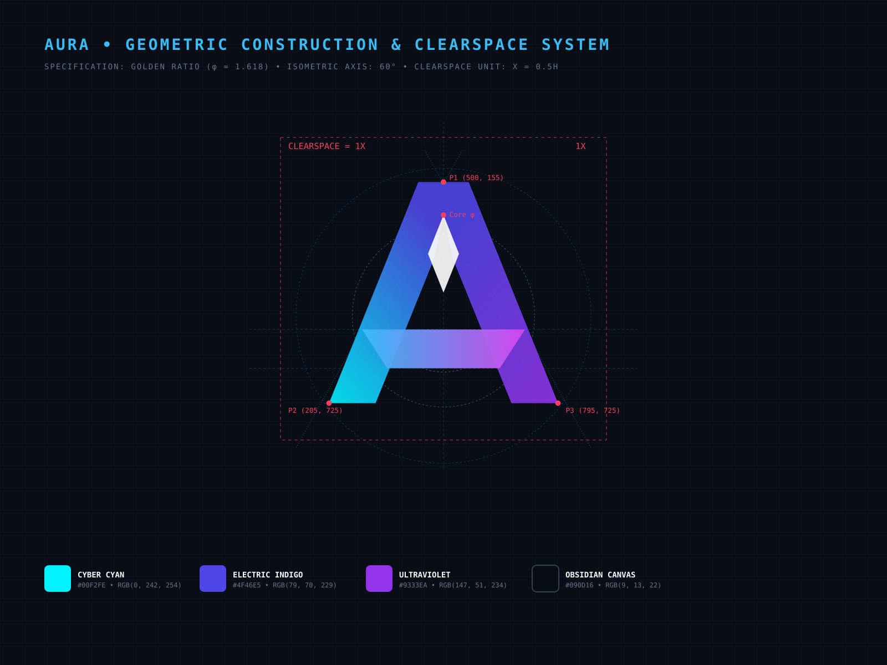

# AURA &bull; Brand Identity &amp; Style Guidelines


---

## 1. Executive Summary & Brand Overview

**AURA** is a fictional ambient intelligence and spatial cognitive technology platform. The company builds non-intrusive neural wearables, circadian ambient displays, and intelligent spatial software designed to help professionals achieve seamless deep work and cognitive vitality.

* **Brand Name:** AURA
* **Category:** Ambient Bio-Intelligence &amp; Spatial Software
* **Tagline:** *Ambient Intelligence*
* **Brand Attributes:** Architectural, Minimalist, Fluid, Precise, Luminous
* **Core Philosophy:** Dieter Rams’ 10th Principle — *"Good design is as little design as possible."*

---

## 2. Logo Concept &amp; Design Rationale

> **Official Design Rationale (LinkedIn &amp; Portfolio Ready):**  
> *"The AURA identity unites an ascending architectural 'A' with an interlocking continuous Möbius ribbon, symbolizing seamless cognitive flow, spatial elevation, and ambient awareness. The color harmony transitions from Cyber Cyan (`#00F2FE`) to Electric Indigo (`#4F46E5`) and Ultraviolet (`#9333EA`)&mdash;balancing high-tech mathematical precision with human vitality across an obsidian canvas."*

### Key Concept Drivers
1. **The Architectural Apex ('A'):** Represents elevation, cognitive growth, and technological excellence.
2. **The Möbius Horizon Loop:** A continuous, single-surface loop representing the infinite feedback loop between human biology and ambient technology.
3. **The Core Focal Diamond:** Represents the spark of human consciousness anchored at the center of the ambient field.

---

## 3. Geometric Construction &amp; Clearspace Grid

The logo was engineered using strict mathematical ratios and golden ratio circular arcs.



* **Isometric Alignment:** All diagonal slopes are pinned to exact $60^\circ$ and $120^\circ$ angles.
* **Golden Ratio ($\phi = 1.618$):** The ratio between the outer apex height and the central crossbar placement is calibrated to $\phi$.
* **Negative Space Counterforms:** A $16\text{px}$ optical isolation channel is engineered between intersecting facets, ensuring maximum legibility in monochrome printing, laser cutting, and embossing.
* **Clearspace Rule ($1X$):**
  * The clearspace zone around the logo is defined as $1X$, where $X = 0.5 \times \text{Height}$ of the logo mark.
  * No secondary text, graphics, or page edges may intrude into this zone.

---

## 4. Logo Variants &amp; Deliverables Matrix

All files are provided in both **scalable vector format (SVG)** and **retina $2000\times2000\text{px}$ PNG format with 32-bit transparent alpha channels**.

| Variant | Description | Vector Asset (SVG) | High-Res PNG (2000px+) | Intended Application |
| :--- | :--- | :--- | :--- | :--- |
| **Full Colour Symbol** | Luminous multi-stop gradient with ambient depth | [`aura_logo_symbol_color.svg`](../assets/vectors/aura_logo_symbol_color.svg) | [`aura_symbol_color_2000px.png`](../assets/png_exports_2000px/aura_symbol_color_2000px.png) | Primary digital mark, app launch splash, social avatars |
| **Monochrome Black** | Pure `#09090B` with optical counter-channels | [`aura_logo_symbol_black.svg`](../assets/vectors/aura_logo_symbol_black.svg) | [`aura_symbol_black_2000px.png`](../assets/png_exports_2000px/aura_symbol_black_2000px.png) | Single-ink print, newspaper, invoices, laser etching |
| **Reversed White** | Pure `#FFFFFF` on transparent background | [`aura_logo_symbol_white.svg`](../assets/vectors/aura_logo_symbol_white.svg) | [`aura_symbol_white_2000px.png`](../assets/png_exports_2000px/aura_symbol_white_2000px.png) | Dark mode UI, apparel embroidery, hardware backplates |
| **Horizontal Lockup (Color)** | Symbol + Custom Vector Wordmark + Tagline | [`aura_logo_full_color.svg`](../assets/vectors/aura_logo_full_color.svg) | [`aura_horizontal_color_2000px.png`](../assets/png_exports_2000px/aura_horizontal_color_2000px.png) | Website navigation bar, email signatures, presentation headers |
| **Horizontal Monochrome** | Single-color black horizontal lockup | [`aura_logo_monochrome_black.svg`](../assets/vectors/aura_logo_monochrome_black.svg) | [`aura_horizontal_black_2000px.png`](../assets/png_exports_2000px/aura_horizontal_black_2000px.png) | Legal contracts, letterheads, co-branding partnerships |
| **Horizontal Reversed** | Single-color white horizontal lockup | [`aura_logo_reversed_white.svg`](../assets/vectors/aura_logo_reversed_white.svg) | [`aura_horizontal_white_2000px.png`](../assets/png_exports_2000px/aura_horizontal_white_2000px.png) | Dark website headers, event backdrops, merchandise |
| **Vertical Stacked Lockup** | Centered symbol over wordmark | [`aura_logo_vertical_color.svg`](../assets/vectors/aura_logo_vertical_color.svg) | [`aura_vertical_color_2000px.png`](../assets/png_exports_2000px/aura_vertical_color_2000px.png) | Vertical posters, booth rollups, packaging boxes |
| **App Icon Squircle** | 22.5% squircle with glass rim reflection | [`aura_logo_app_icon.svg`](../assets/vectors/aura_logo_app_icon.svg) | [`aura_app_icon_2000px.png`](../assets/png_exports_2000px/aura_app_icon_2000px.png) | iOS, macOS, iPadOS, Android home screen &amp; dock icon |

---

## 5. Color Architecture

The AURA palette bridges technological precision with organic vitality.

```
+---------------------------------------------------------------------------------+
|  CYBER CYAN        RADIANT SKY       ELECTRIC INDIGO    ULTRAVIOLET    OBSIDIAN |
|    #00F2FE           #38BDF8             #4F46E5          #9333EA       #090D16 |
+---------------------------------------------------------------------------------+
```

### Color Codes Table

| Name | Role | HEX | RGB | CMYK |
| :--- | :--- | :--- | :--- | :--- |
| **Cyber Cyan** | Primary Accent / Ascent | `#00F2FE` | `0, 242, 254` | `62, 0, 10, 0` |
| **Radiant Sky** | Secondary Highlight | `#38BDF8` | `56, 189, 248` | `65, 12, 0, 0` |
| **Electric Indigo** | Core Brand Anchor | `#4F46E5` | `79, 70, 229` | `80, 75, 0, 0` |
| **Ultraviolet** | Tertiary Horizon Loop | `#9333EA` | `147, 51, 234` | `66, 84, 0, 0` |
| **Obsidian Canvas** | Dark Background Canvas | `#090D16` | `9, 13, 22` | `85, 78, 62, 85` |
| **Crisp Slate** | Text &amp; Light Canvas | `#F8FAFC` | `248, 250, 252` | `2, 1, 0, 0` |

---

## 6. Typography &amp; Letterforms

### Wordmark Construction
The **AURA** wordmark has been converted to 100% mathematical vector paths to ensure flawless rendering across Adobe Illustrator, Figma, browsers, and print RIP software.
* **Apex Alignment:** The letter **'A'** features a $68^\circ$ apex angle directly echoing the symbol mark.
* **Geometric Symmetry:** The letter **'U'** is built with continuous parabolic tangent arcs.
* **Diagonal Terminal:** The letter **'R'** features an open diagonal leg with a $68^\circ$ chamfered foot.
* **Optical Tracking:** Letter spacing is set to $+350$ units (`0.35em`) to evoke luxury minimalism.

### System Type Pairings
* **Display / Headings:** *Plus Jakarta Sans* or *Inter Display* (Weights: 600 SemiBold, 800 ExtraBold)
* **Body Copy:** *Inter* or *system-ui* (Weight: 400 Regular, Line-height: 1.6)
* **Metadata &amp; Technical Specs:** *JetBrains Mono* (Weight: 500 Medium)

---

## 7. Brand Do's &amp; Don'ts

### Do's:
1. **Always scale proportionally:** Lock aspect ratio when resizing vector or raster assets.
2. **Respect the clearspace:** Keep at least $1X$ free zone around the perimeter.
3. **Use monochrome black for print:** For single-color newsprint, stamps, or laser etching, use [`aura_logo_symbol_black.svg`](../assets/vectors/aura_logo_symbol_black.svg).
4. **Use reversed white on dark:** On photography or dark surfaces with $>70\%$ luminance value, use [`aura_logo_symbol_white.svg`](../assets/vectors/aura_logo_symbol_white.svg).

### Don'ts:
1. **Never skew or rotate** the logo off its standard horizontal orientation.
2. **Never alter the facet colors** or replace the gradient with unapproved swatches.
3. **Never add artificial bevels, outer glows, or drop shadows** beyond the master SVG specification.
4. **Never crowd the mark** with competing typography or clip art elements.

---

&copy; 2026 AURA Ambient Intelligence &bull; Oasis Infobytes Internship Task Deliverable.
