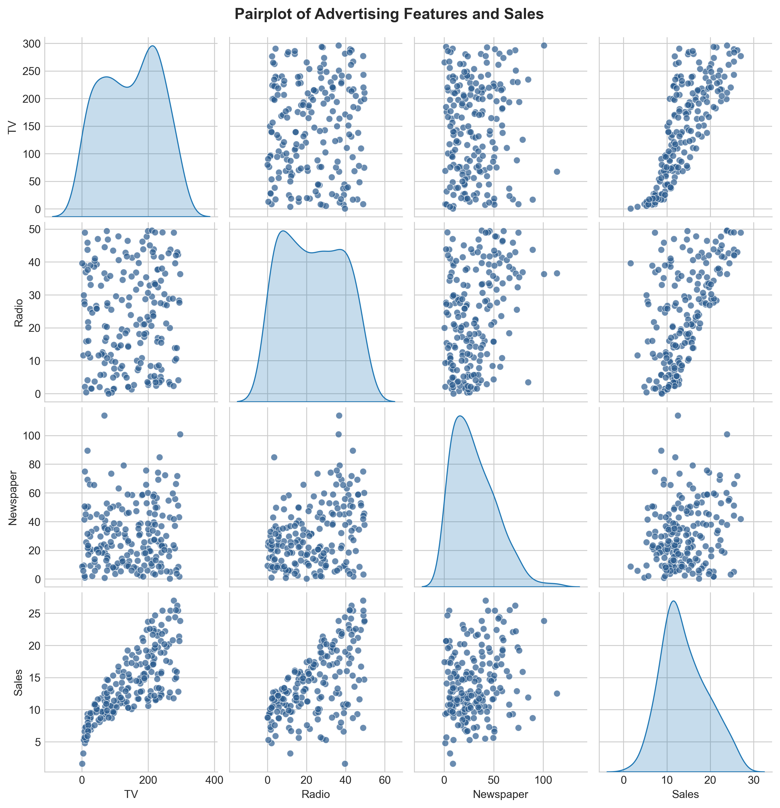
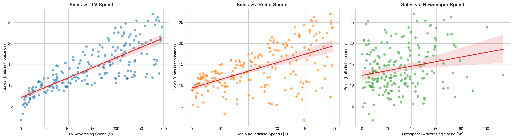
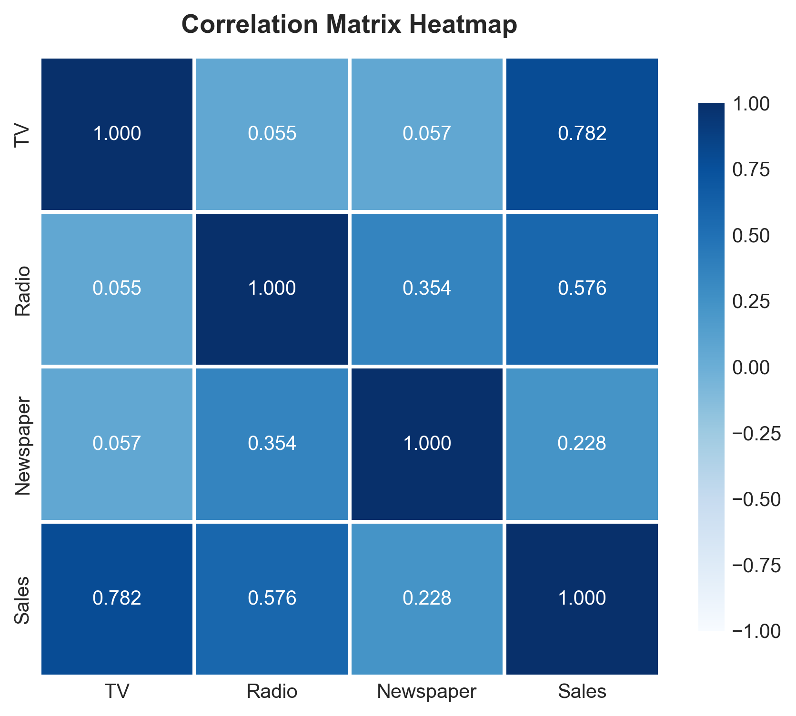
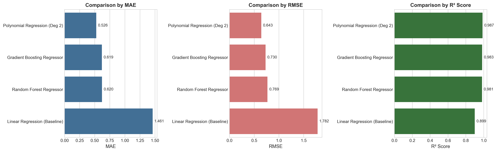
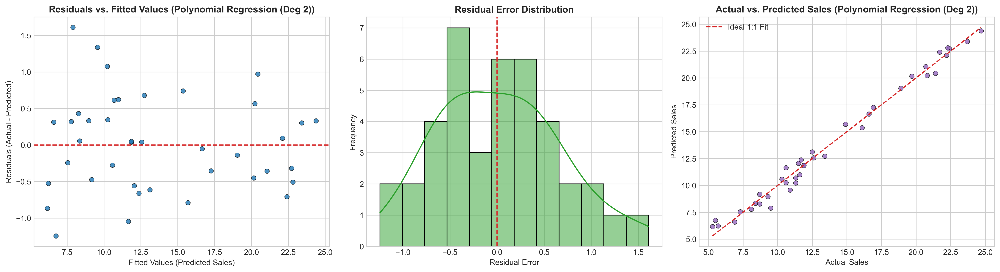
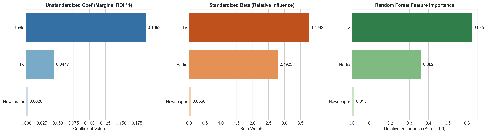

# 📊 Sales Prediction Using Python

> **Oasis Infobytes Data Science Internship · Task 5**  
> *A Machine Learning Regression Project for Multi-Channel Advertising Budget Optimization & Sales Forecasting.*

---

## 📌 Project Overview
Sales prediction is an essential forecasting tool in corporate marketing analytics. When an organization allocates its advertising budget across diverse communication channels (**Television**, **Radio**, and **Newspaper**), leadership must understand:
1. **Accurate Forecasting:** How reliably can we predict unit sales from planned marketing expenditure?
2. **Channel Sensitivity & Marginal ROI:** Which channel drives the highest marginal return per dollar invested?
3. **Synergy & Cross-Channel Multipliers:** Does combined multi-channel advertising produce compounding returns?
4. **Budget Reallocation:** Which underperforming channels should be defunded to maximize net revenue?

This project develops, validates, and diagnoses multiple regression models to solve these business questions.

---

## 🛠️ Tech Stack & Dependencies
- **Core Language:** Python 3.10+
- **Data Manipulation:** `pandas`, `NumPy`
- **Machine Learning:** `scikit-learn`
- **Visualization:** `matplotlib`, `seaborn`
- **Interactive Environment:** `Jupyter Notebook` / `JupyterLab`

---

## 📁 Repository Structure
```
DATA SCIENCE- TASK 5 · Sales Prediction Using Python/
│
├── Advertising.csv                       # Dataset (200 records: TV, Radio, Newspaper, Sales)
├── Sales_Prediction_Using_Python.ipynb   # Fully executed & well-commented Jupyter Notebook
├── sales_prediction.py                  # Standalone automated Python production pipeline
├── create_notebook.py                   # Automated notebook build script
├── README.md                            # Comprehensive project documentation
│
└── plots/                               # High-resolution (300 DPI) exported figures
    ├── 01_pairplot.png                  # Multi-feature pairplot with KDE
    ├── 02_individual_scatter_plots.png  # Individual channel regression scatter plots
    ├── 03_correlation_heatmap.png       # Annotated Pearson correlation heatmap
    ├── 04_model_comparison.png          # MAE, RMSE, and R² benchmark bar plots
    ├── 05_residual_analysis.png         # Residuals vs fitted, error distribution, 1:1 fit
    └── 06_channel_impact_comparison.png # Marginal ROI, Standardized Beta, RF Importance
```

---

## 🔍 Dataset Description
The dataset (`Advertising.csv`) consists of **200 observations** recording advertising spend across media channels (measured in thousands of dollars) and corresponding product sales (in thousands of units):

| Variable | Type | Description | Range ($k$) |
|---|---|---|---|
| **TV** | Feature (`float64`) | Advertising budget allocated to TV media | \$0.70k - \$296.40k |
| **Radio** | Feature (`float64`) | Advertising budget allocated to Radio broadcasts | \$0.00k - \$49.60k |
| **Newspaper** | Feature (`float64`) | Advertising budget allocated to print Newspapers | \$0.30k - \$114.00k |
| **Sales** | Target (`float64`) | Total unit sales generated in thousands | 1.60k - 27.00k units |

- **Missing Values:** 0 missing values across all columns.
- **Outliers / Skew:** Newspaper spend is moderately right-skewed; TV and Radio exhibit broad, balanced distributions.

---

## 📈 Exploratory Data Analysis (EDA) Highlights

### 1. Pairplot Analysis

- A non-linear upward curve is visible between **TV** and **Sales**.
- **Radio** displays moderate positive linear spread with Sales.
- **Newspaper** exhibits high variance and weak alignment with Sales.

### 2. Individual Channel Scatter Plots

- **Sales vs. TV:** Strong positive trend ($r = 0.782$); points cluster steadily along the regression line.
- **Sales vs. Radio:** Positive trend ($r = 0.576$), showing noticeable acceleration when combined with high TV spend.
- **Sales vs. Newspaper:** Wide cloud with weak slope ($r = 0.228$); high newspaper expenditure does not guarantee high sales.

### 3. Pearson Correlation Heatmap


```
Ranked Pearson Correlation with Sales:
Sales        1.000000
TV           0.782224
Radio        0.576223
Newspaper    0.228299
```

---

## ⚙️ Model Development & Benchmark Comparison

The dataset was split using an **80% training / 20% test** partition (`random_state=42`). Four models were trained and evaluated:

1. **Multiple Linear Regression (Baseline):**
   $$\text{Sales} = \beta_0 + \beta_1 \cdot \text{TV} + \beta_2 \cdot \text{Radio} + \beta_3 \cdot \text{Newspaper}$$
2. **Polynomial Regression (Degree 2 with Interactions):**
   Captures diminishing returns and cross-channel synergies ($\text{TV}^2$, $\text{Radio}^2$, $\text{TV} \times \text{Radio}$).
3. **Random Forest Regressor:**
   Non-parametric ensemble of 100 decision trees.
4. **Gradient Boosting Regressor:**
   Sequential boosting building shallow trees iteratively on residual loss.

### 🏆 Benchmark Comparison Table
| Rank | Model Architecture | MAE (k units) | RMSE (k units) | $R^2$ Score | Performance Assessment |
|:---:|---|:---:|:---:|:---:|---|
| 🥇 | **Polynomial Regression (Deg 2)** | **0.5262** | **0.6426** | **0.9869** | **Best Model** (Captures cross-media synergy) |
| 🥈 | **Gradient Boosting Regressor** | 0.6187 | 0.7298 | 0.9831 | Excellent non-linear performance |
| 🥉 | **Random Forest Regressor** | 0.6201 | 0.7686 | 0.9813 | Robust tree ensemble |
| 4 | **Linear Regression (Baseline)** | 1.4608 | 1.7816 | 0.8994 | Standard linear baseline |



---

## 🔬 Residual & Diagnostic Analysis
To confirm that model errors are genuine stochastic noise rather than unmodeled patterns, diagnostic tests were conducted on the best-performing model (**Polynomial Regression**):



- **Mean Error:** $\mu = 0.0168$ (tightly centered at zero).
- **Homoscedasticity:** Residuals are uniformly and randomly scattered around the zero horizontal line without systematic funneling or parabolic curvature.
- **Normality:** Error distribution closely conforms to a normal bell curve.
- **Actual vs. Predicted Alignment:** Predicted values closely trace the $45^\circ$ reference identity line with no systematic over- or under-prediction.

---

## 💡 Channel Impact Interpretation: Which Medium Matters Most?

To answer **"Which advertising channel has the highest impact on sales?"**, three distinct analytical lenses were evaluated:



| Channel | Linear Reg. Coef ($\beta_{unstd}$) | Standardized Beta ($\beta_{std}$) | Random Forest Feature Importance | Primary Role in Advertising Strategy |
|---|:---:|:---:|:---:|---|
| **TV** | $+0.0447$ | **$+3.7642$** | **$62.48\%$** | **Volume Foundation:** Strongest overall determinant of aggregate sales. |
| **Radio** | **$+0.1892$** | $+2.7923$ | $36.22\%$ | **Marginal Efficiency:** Highest return per incremental dollar spent. |
| **Newspaper** | $+0.0028$ | $+0.0560$ | $1.30\%$ | **Negligible Impact:** Statistically ineffective channel. |

### 🎯 Strategic Business Recommendations:
1. **TV is the Core Driver of Sales Volume:** With **62.5%** feature importance and a standardized beta of **3.76**, TV provides essential brand awareness that forms the baseline for all revenue.
2. **Radio Delivers the Highest Marginal ROI:** At **+0.189 sales units per \$1,000**, radio delivers roughly **$4.2\times$ the incremental unit return per dollar** compared to TV.
3. **Synergy is Critical ($TV \times Radio$):** Polynomial regression significantly outperforming linear regression ($98.7\%$ vs $89.9\%$ variance explained) confirms a strong **cross-media interaction**. Customers exposed to TV commercials respond with significantly higher conversion rates when re-engaged via Radio.
4. **Defund Newspaper Spend:** Newspaper advertising accounts for barely **1.3%** of predictive importance. Its budget should be reallocated to TV and Radio campaigns.

---

## 🚀 How to Run the Project

### Option A: Interactive Jupyter Notebook
```bash
# Launch JupyterLab or Notebook
jupyter notebook Sales_Prediction_Using_Python.ipynb
```
Open the notebook in your browser or VS Code to step through code cells, interact with plots, and experiment with custom budget forecasts.

### Option B: Automated Command-Line Execution
```bash
# Execute the complete end-to-end Python pipeline
python sales_prediction.py
```
This runs data profiling, trains all models, prints formatted metric tables, and saves all 6 diagnostic charts into the `plots/` folder.

---

## 👤 Author
- **Internship:** Oasis Infobytes · Data Science Internship
- **Task:** Task 5 — Sales Prediction Using Python
